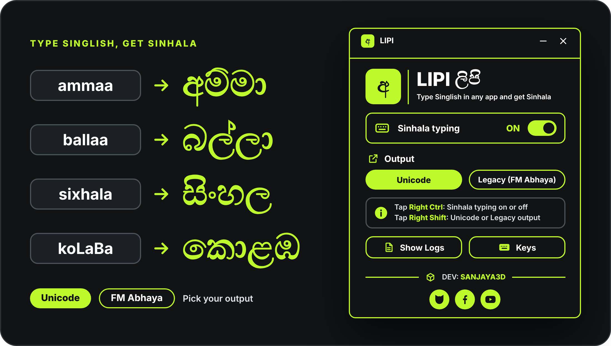

<p align="center">
  
</p>

<p align="center">
  
  
  
  
</p>

<p align="center">
  <a href="https://github.com/sanjaya3d/LIPI/releases/latest">
    
  </a>
</p>

<p align="center">
  <a href="#features">Features</a> &nbsp;·&nbsp;
  <a href="#quick-start">Quick start</a> &nbsp;·&nbsp;
  <a href="#how-to-type">How to type</a> &nbsp;·&nbsp;
  <a href="#settings">Settings</a> &nbsp;·&nbsp;
  <a href="#build-from-source">Build</a>
</p>

**Type Singlish in any app and get Sinhala, live, as you type.** Type `ammaa` and LIPI writes අම්මා in Photoshop, Premiere Pro, Blender, Word, your browser and any other Windows app. The output can be Unicode or FM Abhaya.

Windows program written in Rust · GPL-3.0-or-later · by **SANJAYA3D**

> **ලිපි** යනු ඉංග්‍රීසි අකුරින් (Singlish) ටයිප් කරන දේ ඒ මොහොතේම සිංහල අකුරු බවට හරවන කුඩා Windows වැඩසටහනකි. උදාහරණයක් ලෙස `ammaa` ටයිප් කළ විට අම්මා ලැබේ. Photoshop, Premiere Pro, Blender වැනි ඕනෑම app එකක මෙය වැඩ කරයි. Unicode සහ FM Abhaya (legacy) යන දෙවර්ගයෙන්ම සිංහල ලිවිය හැක.

<p align="center">
  
</p>

<p align="center"><sub>Illustration (generated for this README, not a screenshot): four example words and the LIPI window.</sub></p>

## Features

- **Works in any app.** LIPI watches the keyboard for the whole system, so it works wherever you can type.
- **Two outputs.** Unicode, and FM Abhaya (legacy) for apps that cannot show Unicode Sinhala properly.
- **Live typing.** The word is redrawn after every key, and Backspace works one English letter at a time.
- **Punctuation in legacy mode.** Keys such as `?` `.` `:` `%` `!` `(` `)` type the right FM Abhaya codes, so you do not have to switch outputs (US keyboard layout).
- **Tiny.** One small exe. No installer, no libraries (Rust standard library only), about 2 MB of RAM on the author's PC.
- **Lives in the tray.** Left click the tray icon to open the window. Right click to switch Sinhala typing on or off.
- **Key hints inside the window.** The **Keys** button shows what to type for each letter. `lipi --keys` prints the same chart in a terminal.
- **Your own map.** You can use your own FM Abhaya map file.
- **Private.** No network code. Nothing you type leaves your computer.

## Quick start

1. Download `lipi.exe` from the [latest release](https://github.com/sanjaya3d/LIPI/releases/latest) and run it. The window opens.
2. Tap **Right Ctrl** to switch Sinhala typing on or off.
3. Tap **Right Shift** to switch between Unicode and legacy (FM Abhaya) output.
4. Type in any app. For example `ballaa` gives බල්ලා.

You can change both keys, and what the program starts with, in [`settings.txt`](#settings).

## How to type

- Keys are case-sensitive: `ta` gives ට and `Ta` gives ඨ, `na` gives න and `Na` gives ණ.
- A consonant on its own gets a hal: `k` gives ක්, and `ka` gives ක.
- Two consonants in a row join up. `y` and `r` after another consonant make yansaya and rakaransaya: `kya` gives ක්‍ය and `kra` gives ක්‍ර.
- `x` or `zn` gives ං, `H` gives ඃ and `X` gives ඞ. Type them after a Sinhala letter: `kax` gives කං, `kaH` gives කඃ and `kaX` gives කඞ.
- A capital letter that no key uses is read as lowercase, so `Kamal` gives කමල්.
- Anything LIPI does not know, such as digits and punctuation, is passed through as typed.

<details>
<summary><b>Key chart</b> (the output of <code>lipi --keys</code>)</summary>

```
== Vowels ==
අ a          ආ aa         ඇ A          ඈ Aa
ඉ i          ඊ ii         උ u          ඌ uu
ඍ R          ඎ Ru         එ e          ඒ ee
ඓ ai         ඔ o          ඕ oo         ඖ au
Also: AA = ඈ, ou = ඖ. Straight after a consonant, use the Signs tab.

== Consonants ==
ක ka         ඛ kha        ග ga         ඝ gha        ඟ zga
ච cha        ඡ chha       ජ ja         ඦ zja        ඤ zka
ඥ zha        ට ta         ඨ Ta         ඩ da         ඪ Da
ණ Na         ඬ zda        ත tha        ථ thha       ද dha
ධ dhha       න na         ඳ zdha       ප pa         ඵ pha
බ ba         භ bha        ම ma         ඹ Ba         ය ya
ර ra         ල la         ළ La         ව wa         ශ sha
ෂ Sha        ස sa         හ ha         ෆ fa
Also: q = ද, zq = ඳ, v = ව, S = ෂ. A letter on its own gets a hal: k = ක්

== Signs ==
ක ka         කා kaa        කැ kA         කෑ kAa
කි ki         කී kii        කු ku         කූ kuu
කෘ kru        කෲ kruu       කෙ ke         කේ kee
කෛ kai        කො ko         කෝ koo        කෞ kau
Type them after a consonant. Also: AA = කෑ

== Examples ==
ක් k          කං kax
කං kazn       කඃ kaH
කඞ kaX        ක්‍ය kya
ක්‍ර kra        මම mama
අම්මා ammaa      ගෙදර gedhara
නුවර nuwara     කොළඹ koLaBa
සිංහල sixhala    ප්‍රශ්න prashna
Capitals matter: ta = ට, Ta = ඨ. x, zn, H and X are typed after a letter.
```

</details>

## Output types

**Unicode** is normal Sinhala text. It works in modern apps and websites.

**Legacy (FM Abhaya)** is for apps that cannot shape Unicode Sinhala. LIPI turns the Sinhala into FM Abhaya character codes using a conversion table. The text looks right when the font is FM Abhaya, so that font must be installed.

To use your own table, copy `src/legacy_map.txt` next to the exe, edit it, and restart the program. You can also start with `lipi --map my.txt`.

To convert a text file from Unicode to FM Abhaya:

```
lipi --convert < unicode.txt > legacy.txt
```

## Settings

LIPI keeps its settings in your AppData folder, which Explorer hides by default, so no settings file sits next to the exe. To open the folder, press **Win + R**, type `%APPDATA%\LIPI` and press Enter. The file `settings.txt` is created there the first time LIPI runs.

```
# Tap this key alone to switch Sinhala typing on or off.
on_off_key = RightCtrl

# Tap this key alone to switch between Unicode and legacy output.
output_key = RightShift

# What the program starts with.
start_typing = on
start_output = unicode

# yes: start hidden in the tray. no: open the window.
start_in_tray = no
```

Comments must be on their own lines, starting with `#`.

Choices for the two keys: `RightCtrl`, `LeftCtrl`, `RightShift`, `LeftShift`, `RightAlt`, `LeftAlt`, `ScrollLock`, `Pause`. They must be different keys. Change a value, save, and restart the program.

If you used an older version that kept `settings.txt` next to the exe, LIPI moves that file to the new folder the first time it runs.

## Command line

| Command | What it does |
| --- | --- |
| `lipi` | Opens the window |
| `lipi --legacy` | Starts with legacy output |
| `lipi --console` | No window, log lines in the console |
| `lipi --test` | Terminal tester: type Singlish, see both outputs |
| `lipi --keys` | Prints the key chart |
| `lipi --chart` | Prints the legacy check sheet |
| `lipi --convert` | Converts Unicode text from the keyboard or a pipe to FM Abhaya |
| `lipi --map my.txt` | Uses your own legacy map (works with all of the above) |

A release build has no console window, so `--test`, `--chart`, `--keys` and `--console` print nothing in it. Run them with `cargo run -- --keys` instead.

## How it works

1. A Windows keyboard hook sees each key press before the app does.
2. LIPI keeps the English letters of the word you are typing. The word ends at a space, punctuation, Enter, an arrow key, a mouse click or a change of window. Shortcuts with Ctrl, Alt or the Windows key are left alone.
3. After every key, the whole word is converted again with the rules above.
4. The app never receives your English letter. LIPI sends it the smallest change instead: a few backspaces, then the new Sinhala characters.

## Privacy

LIPI has no network code and sends nothing anywhere. The Show Logs window keeps its lines in memory only, and nothing is saved to a file. The only file the program writes is `settings.txt`.

## Limits

- Windows only.
- In an app that runs as administrator, LIPI must also run as administrator, or Windows will block it.
- Turn Sinhala typing off (tap Right Ctrl) before you type a password, or the letters will be converted too.
- The exe is not code-signed, so some antivirus programs may warn about it. The source code is here, so you can read it and build it yourself.
- FM Abhaya output needs the FM Abhaya font in the app you paste into.
- The legacy punctuation table is made for the US keyboard layout.

## Build from source

Install Rust with the MSVC toolchain, then run this in the project folder:

```
cargo build --release
```

The program is `target\release\lipi.exe`. The exe icon comes from `lipi.ico` and is added at build time. To run the tests:

```
cargo test
```

## Project layout

| File | What it does |
| --- | --- |
| `src/engine.rs` | Singlish to Sinhala Unicode, and the word composer |
| `src/legacy.rs`, `src/legacy_map.txt` | Sinhala Unicode to FM Abhaya |
| `src/session.rs` | The word being typed, for either output type |
| `src/keymap.rs` | What each key press means |
| `src/win.rs` | The Windows keyboard hook |
| `src/settings.rs`, `src/state.rs` | Settings and shared state |
| `src/gui.rs`, `src/layout.rs`, `src/icons.rs`, `src/theme.rs` | The window, drawn by hand with no libraries |
| `src/hints.rs` | The key hint page |
| `src/about.rs` | Name and contact links |
| `build.rs` | Adds the icon to the exe |

## Feedback

Found a wrong letter or a bad FM Abhaya glyph? [Open an issue](https://github.com/sanjaya3d/LIPI/issues) with the word you typed and what you expected.

## License

LIPI is free software under the [GNU General Public License v3.0 or later](LICENSE).

## Author

Made by **SANJAYA3D**

[GitHub](https://github.com/sanjaya3d) &nbsp;·&nbsp; [Facebook](https://facebook.com/sanjaya3d) &nbsp;·&nbsp; [YouTube](https://www.youtube.com/@SANJAYA3D/)
